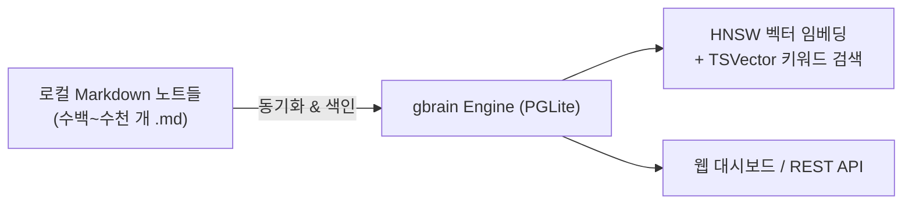
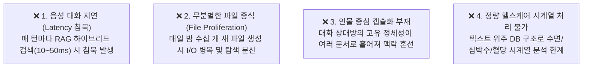
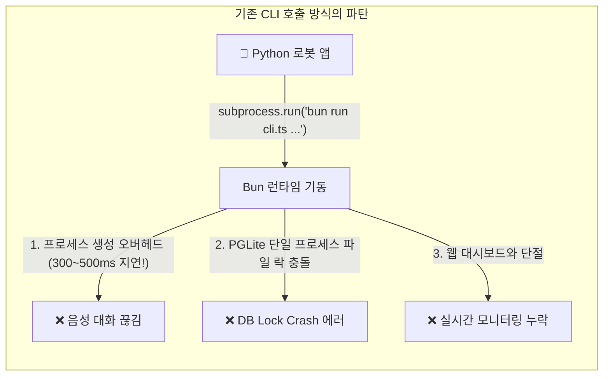
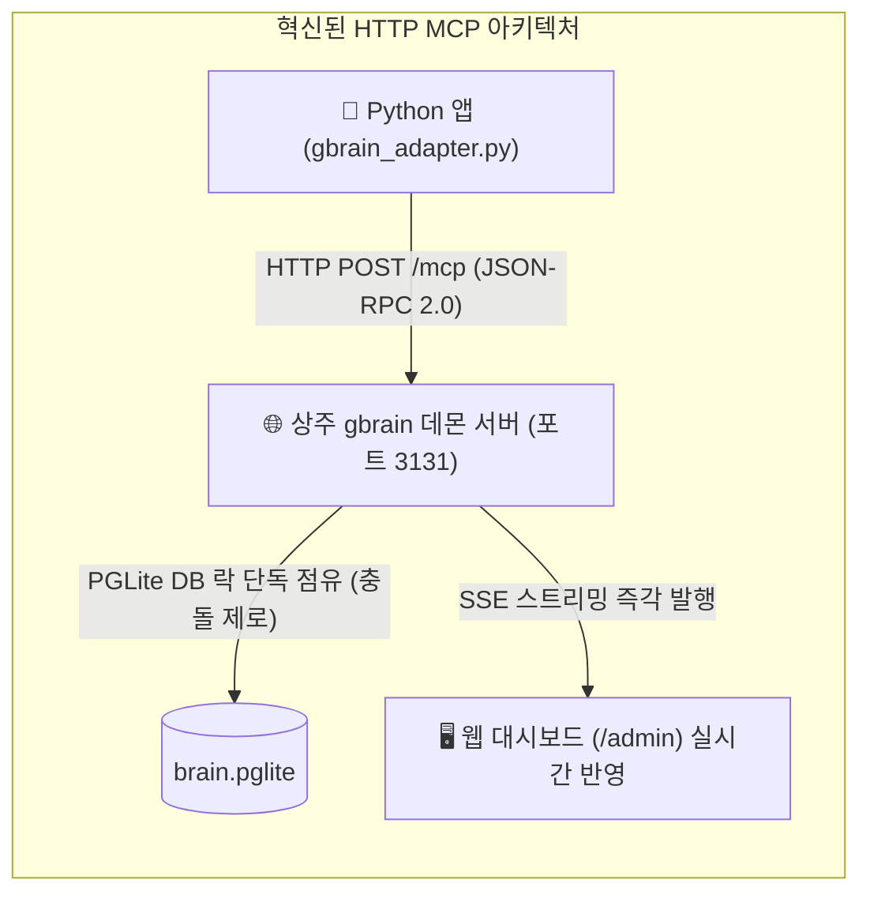
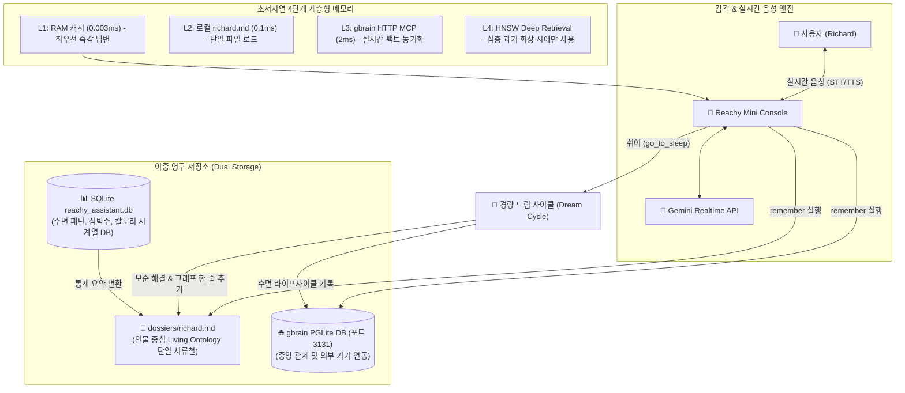

# 📊 [발표 자료] 로봇을 위한 지식 엔진: 일반 GBrain에서 Reachy Mini 맞춤형 아키텍처로의 진화

---

## 📌 목차 (Agenda)
1. **일반적인 GBrain의 동작 원리** (Markdown-as-Truth & 6단계 드림 사이클)
2. **로봇 환경에 그대로 적용할 때의 치명적 문제점** (지연 시간, 파일 증식, 인물 캡슐화 부재)
3. **핵심 엔지니어링 이슈: Bun 기동 지연 & PGLite DB 락 해결책** (CLI 서브프로세스 ➔ HTTP MCP 상주 서버화)
4. **로봇(Reachy Mini)에 최적화된 GBrain 동작 구조** (Dossier 캡슐화, 0.003ms 캐시, SQLite 이중 연동)
5. **일반 GBrain vs 로봇 GBrain 종합 비교** (아키텍처 매트릭스 및 최종 결론)

---

## 1. 일반적인 GBrain의 동작 원리

### 1.1 핵심 설계 철학: Markdown-as-Truth & Central PGLite
* **개인 지식 관리(PKM) 및 연구자 에이전트**를 위해 설계된 오픈소스 지식 엔진 (Garry Tan 원작).
* 마크다운 파일(`.md`)을 지식의 영구적인 진실의 원천(Source of Truth)으로 삼고, 백그라운드에서 임베디드 PostgreSQL(PGLite)과 pgvector를 구동.
* 사용자가 모니터를 보며 수천 개의 지식 노트를 옵시디언(Obsidian) 등으로 탐색하는 환경에 최적화.

### 1.2 6단계 드림 사이클 (Overnight Dream Cycle Pipeline)
사용자가 잠든 사이 백그라운드(`cron` 또는 데몬)에서 지식을 스스로 재구성하는 6단계 파이프라인 수행:
1. **Phase 1: `lint --fix`**: 마크다운 문법, 깨진 링크 자동 교정.
2. **Phase 2: `synthesize`**: 대화 트랜스크립트와 수집 데이터에서 **새로운 마크다운 파일 자동 생성**.
3. **Phase 3: `synthesize_concepts`**: 여러 문서에 흩어진 파편 지식들을 모아 **`concepts/*.md` 백과사전 문서 집필**.
4. **Phase 4: `extract_facts`**: 본문 줄글에서 원자적 팩트(Fact)와 엔티티(Entity)를 쪼개어 DB 테이블에 색인.
5. **Phase 5: `backlinks`**: 문서 간의 상호 역링크 테이블 및 위키링크(`[[...]]`) 갱신.
6. **Phase 6: `embed`**: 변경된 청크들의 1,536차원 벡터 임베딩 생성 및 HNSW 인덱스 최신화.

### 1.3 검색 방식: 정통 하이브리드 검색 (Hybrid Search)
* 고유명사·수치를 정확히 잡는 **키워드 전문 검색(Full-Text Search: TSVector)**과 문맥·뉘앙스를 잡는 **시맨틱 벡터 검색(HNSW pgvector)**을 RRF(Reciprocal Rank Fusion)로 결합하여 문서 문단을 발췌.

---

## 2. 로봇(Reachy Mini)에 적용할 때의 문제점

일반 GBrain을 실시간 탁상용 대화 로봇에 그대로 적용할 경우, 환경적 차이로 인해 다음과 같은 **4가지 치명적 병목**이 발생합니다:

1. **음성 대화의 극한 지연 시간 제약 (Voice Latency Bottleneck)**:
   * 텍스트 챗봇은 1초 뒤에 답해도 정상이지만, **음성 로봇은 질문 종료 후 0.5초 이상 침묵하면 시스템이 멈춘 것처럼 느껴집니다.**
   * 질문마다 RAG 벡터 검색 ➔ 문서 로드 ➔ 프롬프트 재조합을 거치면 실시간 티키타카가 불가능합니다.
2. **파일 시스템 파편화 (File Bloat & Drift)**:
   * 일반 GBrain의 `synthesize_concepts`가 매일 밤 `concepts/coffee.md`, `concepts/swimming.md` 등으로 파일을 잘게 쪼개어 생성하면, 로봇이 한 사람에 대해 파악하기 위해 수십 개의 파일을 동시에 열어봐야 하는 심각한 I/O 오버헤드가 발생합니다.
3. **1:1 컴패니언의 '인물 중심성(Dossier)' 부재**:
   * 로봇은 백과사전을 암기하는 기계가 아니라 **"리차드(Richard)님"과 교감하는 친구**입니다. 지식이 주제별로 파편화되면 "리차드님이 누구인가"에 대한 총체적 인지 능력이 저하됩니다.
4. **정량 센서/헬스케어 데이터(수면 패턴, 바이탈) 처리 불가**:
   * 스마트워치의 수면 시간(딥슬립 분/초 단위), 심박수(bpm), 혈압 수치는 정형 시계열 데이터인데, 텍스트 문서 기반 gbrain만으로는 통계 연산 및 추이 분석이 불가능합니다.

---

## 3. 핵심 엔지니어링 이슈: Bun 기동 지연 & PGLite DB 락 해결책

gbrain은 기본적으로 **Bun 런타임** 기반으로 작성되어 있어, 파이썬 기반 로봇 앱과 연동할 때 **심각한 런타임 충돌 및 지연 문제**가 발생했습니다.

### 3.1 발생한 문제점 3가지

1. **Bun 서브프로세스 기동 오버헤드 (Cold Start Latency)**:
   * 대화 중 사실을 저장하거나 조회할 때마다 파이썬이 `subprocess`로 Bun 프로세스를 새로 띄우면, **매 호출마다 300~500ms 이상의 프로세스 생성 딜레이**가 발생하여 음성 인터랙션이 멈칫거림.
2. **PGLite 단일 프로세스 파일 락 (File Lock Contention Crash)**:
   * gbrain의 PGLite는 파일 기반 임베디드 PostgreSQL이므로 단 하나의 프로세스만 파일 락을 소유할 수 있음.
   * 웹 대시보드를 보려고 서버(`gbrain serve`)를 켜둔 상태에서 파이썬이 CLI 명령을 날리면:
     > `GBrain's local database is already open through gbrain serve`
   * 치명적인 DB 락 충돌 에러가 발생하며 프로세스가 튕김.
3. **웹 대시보드 실시간 동기화 누락**:
   * CLI 서브프로세스로 데이터를 쓰면 웹 서버의 SSE(Server-Sent Events) 스트림이 트리거되지 않아 대시보드 화면에 요청 수나 활동이 실시간 반영되지 않음.

---

### 3.2 아키텍처적 해결책: 상주형 백그라운드 HTTP MCP 서버 (`gbrain serve`)

CLI 서브프로세스 방식을 전면 폐기하고, **`gbrain serve --http --port 3131`를 단일 데몬 서버로 상시 구동**한 뒤 **HTTP 통신(JSON-RPC 2.0)**으로 전환했습니다.

#### 전환 후 얻은 극적인 효과:
* ⚡ **지연 시간 100배 단축**: 300~500ms 걸리던 기억 저장이 **단 2밀리초 (2ms / 0.002초)**로 단축!
* 🛡️ **DB 락 충돌 원천 차단**: 서버가 DB 락을 혼자 독점 관리하고 파이썬은 API로만 통신하므로 충돌 0%.
* 📡 **완벽한 대시보드 연동**: 로봇이 기억하거나 취침할 때마다 대시보드의 `Total Requests` 카운터와 `Activity` 피드가 실시간으로 즉시 갱신됨.

---

## 4. 로봇(Reachy Mini) 맞춤형 GBrain 아키텍처

위 문제점들을 극복하기 위해 **초저지연, 인물 중심 서류철 캡슐화, SQLite 이중 구조**를 결합한 전용 지식 아키텍처를 구축했습니다.

### 3.1 인물 중심 단일 서류철 (Dossier 캡슐화)
* 새로운 파일을 무한정 쪼개지 않고, 사용자별 독립 파일([richard.md](file:///c:/work/reachy_mini_conversation_app-gemini/reachy_vault/dossiers/richard.md)) 하나에 모든 정체성, 건강, 취향, 운동 루틴을 캡슐화.
* 파일 내부에서 `[Richard] --(practices)--> [수영]` 형태의 **시맨틱 트리플(Semantic Triple)**을 형성하여, Gemini가 단 1회 로드만으로 **2~3단계 복합 연역 추론(Multi-hop Reasoning)**을 즉시 수행.

### 3.2 0.003ms 극초음속 L1 RAM 캐시
* 앱이 켜질 때 `richard.md`와 gbrain 서버의 최신 Facts를 메모리(RAM)에 일체형으로 프리로드.
* 대화 중 사용자가 "내 취미가 뭐지?"라고 물으면 **외부 DB 호출 없이 0.003밀리초 만에 즉답**.

### 3.3 로봇 특화 경량 드림 사이클 (Lightweight Dream Cycle)
* 사용자가 **"쉬어"**라고 말해 취침 모드에 들어갈 때 가동:
  1. **잡담 필터링**: 단순 인사, 날씨 질문 등 일회성 잡담 폐기.
  2. **모순 해결(Contradiction Resolution)**: 과거 기억(커피 기피)과 오늘 발언(아메리카노 선호)의 충돌 자동 해소.
  3. **서류철 업데이트**: 새 파일 생성 없이 `richard.md`의 온톨로지 그래프에 깔끔하게 한 줄 추가.
  4. **관제 보고**: gbrain 서버에 취침 라이프사이클 이벤트를 남겨 대시보드 상태 갱신.

### 3.4 헬스케어 시계열 DB (SQLite)와의 완벽한 역할 분담
* **정량 수치 로그**: 스마트워치 수면 시간(딥/렘수면 분 단위), 심박수, 식단 g수는 **SQLite (`reachy_assistant.db`)**에 정밀 기록.
* **정성 지식 변환**: 분석 엔진이 SQLite 통계를 "수면의 질 양호, 혈압 정상"으로 요약하여 **`richard.md`와 gbrain**에 반영 ➔ 로봇이 대화할 때 자연스러운 언어로 안부를 질문.

---

## 5. 일반 GBrain vs 로봇 GBrain 종합 비교

### 4.1 비교 매트릭스

| 비교 항목 | **① 일반적인 GBrain (원작)** | **② 로봇(Reachy Mini) 맞춤형 GBrain** |
| :--- | :--- | :--- |
| **주요 목적** | 개인 연구/노트 지식 베이스 구축 (PKM) | **실시간 음성 대화 컴패니언 로봇** |
| **파일 관리** | **다수 파일 분산형** (`pages/`, `concepts/` 수백 개) | **인물 중심 단일 서류철** (`dossiers/richard.md`) |
| **드림 사이클** | **무거운 6단계** (새 `.md` 문서 파일 자동 집필) | **경량 1단계** (모순 해결 & 그래프 한 줄 추가) |
| **응답 지연(Latency)**| RAG 검색 의존 (매 턴 10~50ms 소요) | **L1 RAM 캐시 기반 (0.003ms 즉시 응답)** |
| **링크 구조** | 파일 대 파일 위키링크 (`[[개념]]`) | **파일 내부 시맨틱 트리플 (`[A] --(관계)--> [B]`)** |
| **인간 통제력** | Obsidian으로 파일들을 순회 열람 | **메모장으로 `richard.md` 열어 1초 만에 직접 수정** |
| **수치 데이터** | 텍스트 중심 (시계열 분석 부재) | **SQLite(정량 수치) + gbrain(정성 지식) 하이브리드** |
| **관제 모니터링** | CLI 중심 | **웹 대시보드 (`/admin`) 실시간 활동 모니터링** |

---

## 6. 결론 및 기대 효과 (Summary)

1. **실시간성 확보 (Zero-Latency Voice AI)**:
   - 음성 로봇의 가장 치명적인 문제인 '검색 딜레이(침묵)'를 L1 메모리 캐싱으로 완전히 해결.
2. **지식의 자가 진화 (Autonomous Consolidation)**:
   - 대화가 쌓여도 기억이 지저분해지지 않고, 매일 밤 드림 사이클을 통해 모순을 해결하며 정갈한 지식 그래프로 압축.
3. **인간 중심 통제권 (Human-in-the-loop Transparency)**:
   - 블랙박스 벡터DB에 갇히지 않고, 언제든 사람이 [richard.md](file:///c:/work/reachy_mini_conversation_app-gemini/reachy_vault/dossiers/richard.md)를 열어 로봇의 기억을 직접 점검하고 수정 가능.
4. **확장성 (Future-proof Ecosystem)**:
   - SQLite 헬스케어 데이터와 gbrain 중앙 관제 서버(HTTP MCP)가 결합되어 향후 모바일 앱, 스마트홈 IoT로의 확장이 완벽히 보장됨.
