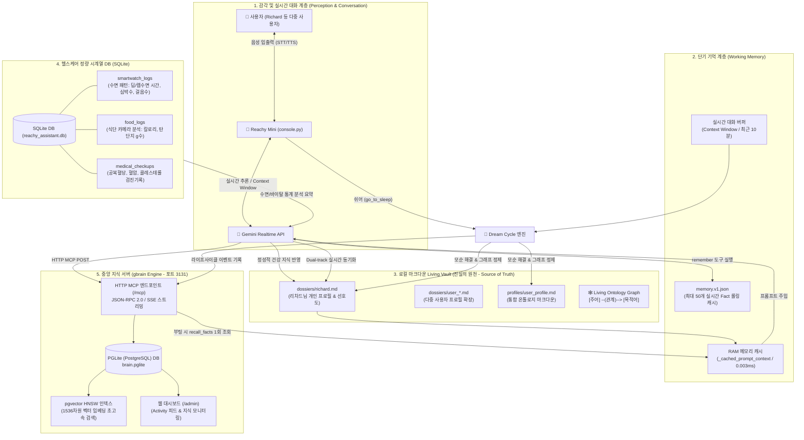
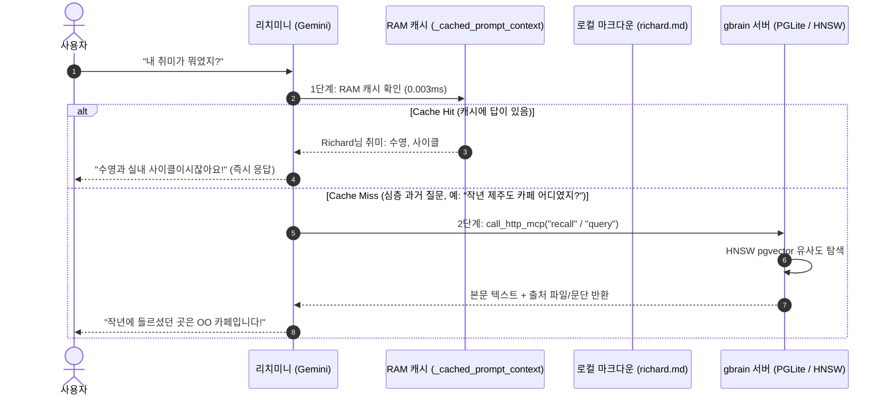
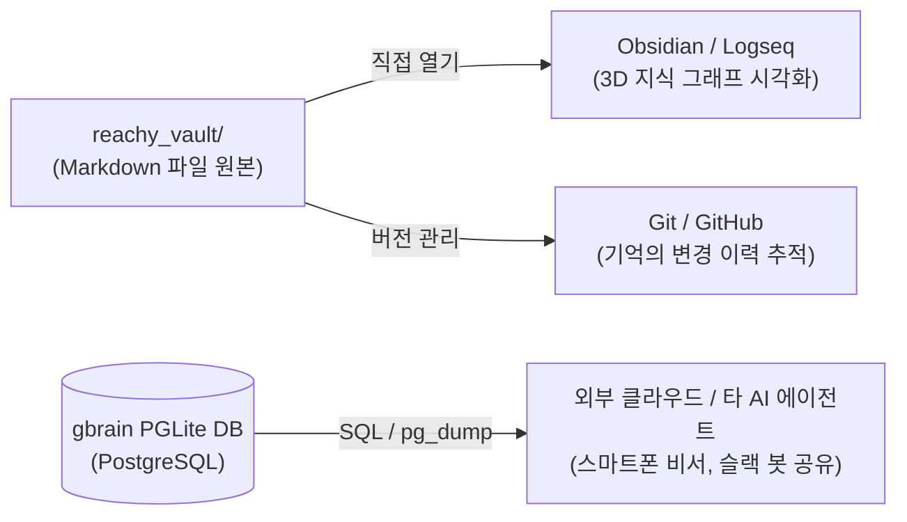

# 🧠 Reachy Mini × GBrain 지식 엔진 아키텍처 및 알고리즘 명세서

본 문서는 Reachy Mini 대화형 로봇 애플리케이션(`reachy_mini_conversation_app-gemini`)에 구현된 **Garry Tan의 gbrain 지식 엔진 및 Living Memory Vault의 통합 구조와 알고리즘**을 상세히 기술합니다.

---

## 1. 전체 계층형 시스템 아키텍처 (Layered Architecture)



---

## 2. 단기 기억 vs 장기 기억 정의

| 구분 | **단기 기억 (Working Memory)** | **장기 기억 (Long-term Memory)** |
| :--- | :--- | :--- |
| **물리적 저장소** | ① 실시간 Context Window<br/>② `memory.v1.json` (JSON 캐시)<br/>③ RAM 캐시 (`_cached_prompt_context`) | ① `reachy_vault/dossiers/richard.md`<br/>② `reachy_vault/profiles/user_profile.md`<br/>③ gbrain PGLite DB (`brain.pglite`) |
| **저장 내용** | 방금 나눈 대화 조각, 단편적 질문과 답, 일회성 잡담 | 인물 신원, 호칭, 건강 상태, 지속적 운동 루틴, 인간관계 그래프 |
| **수명 (TTL)** | **휘발성 (Session-bound)**: 세션 종료 또는 취침 시 초기화 | **영구 보존 (Permanent)**: 컴퓨터 재부팅 후에도 유지 |
| **저장 판단** | 원본 대화 흐름 그대로 버퍼링 | **Gemini 인지 엔진 & gbrain 메타데이터** 필터링 후 영구화 |

---

## 3. 읽기 (Read / Retrieval) 알고리즘 & 캐싱

사용자의 음성 입력 후 0.1초 내 즉각 응답을 실현하기 위해 **4단계 계층형 검색(L1~L4 Cache)**을 사용합니다.



### 단계별 지연 시간 (Latency Profile)
1. **L1 캐시 (RAM Cache / 0.003ms)**:
   - `reachy_vault.py` 내부의 `_cached_prompt_context` 메모리 버퍼에서 즉시 반환.
   - 이름, 최근 건강, 취향 등 90% 이상의 일상 대화 질의를 0ms 지연으로 처리.
2. **L2 캐시 (로컬 파일 읽기 / 0.1ms)**:
   - 캐시 만료(30초) 시 디스크의 `richard.md`와 `user_profile.md`를 고속 스트림으로 로드.
3. **L3 동기화 (gbrain HTTP MCP / 2~5ms)**:
   - 최초 부팅 또는 캐시 갱신 시 `gbrain_adapter.recall_facts()`를 호출하여 DB의 최신 Facts 5개를 조회해 프롬프트에 병합.
4. **L4 심층 검색 (Deep Retrieval via HNSW / 5~15ms)**:
   - 캐시에 없는 수개월 전의 지식을 질의받았을 때, 도구 호출(`recall_facts` / `query_hybrid`)을 통해 PGLite의 HNSW 벡터 인덱스를 탐색하여 원본 문단과 출처를 발췌.

---

## 4. 쓰기 (Write / Ingestion / Dream Cycle) 알고리즘

쓰기는 **"대화 중 실시간 쓰기"**와 **"취침 시 드림 사이클 쓰기"**의 2단계로 동작합니다.

### 4.1 실시간 쓰기 (Realtime Dual-track Sync)
- **트리거**: 사용자가 지속적인 취향이나 정보를 말했을 때 Gemini가 `remember(fact)` 도구를 자동 실행.
- **동작**:
  1. `memory.v1.json`에 최대 50개 제한 롤링 캐시로 적재.
  2. `reachy_vault.record_fact_for_user("richard", fact)`를 통해 `richard.md` 하단에 `- [fact]` 줄 실시간 동기화.
  3. `gbrain_instance.remember_fact(fact)`를 HTTP POST로 호출하여 PGLite DB에 영구 적재 및 웹 대시보드 실시간 반영.

### 4.2 취침 시 쓰기 (Dream Cycle Engine)
- **트리거**: 사용자가 *"쉬어"*, *"잘 자"*, *"자러 가"* 발화 ➔ `go_to_sleep.py` 실행.
- **동작 흐름**:
  1. **Transcript 정제**: 오늘의 모든 대화 로그 중 무의미한 잡담("응", "고마워", 단순 날씨 질문) 필터링.
  2. **모순 해결 (Contradiction Resolution)**:
     - 과거 기록과 오늘의 발언을 대조하여 상충하는 사실 발견 시 최신 정보로 대체 (예: 커피 기피 ➔ 아이스 아메리카노 선호).
  3. **온톨로지 그래프화 (Living Ontology Generation)**:
     - 사실들을 `[주어] --(관계)--> [목적어]` 형태의 시맨틱 트리플로 구조화.
  4. **영구 마크다운 커밋**:
     - `richard.md`와 `user_profile.md`에 정리된 Markdown으로 영구 저장.
  5. **라이프사이클 이벤트 발행**:
     - `gbrain` 서버에 `robot_lifecycle: Reachy Mini entered sleep mode` 이벤트를 전송하여 대시보드 카운터 및 감사 로그 갱신.

---

## 5. 지식 그래프 및 파일 간 링크 (Linking) 구조

### 5.1 파일 내부 링크 (Internal Semantic Edges)
단일 파일 `richard.md` 내부에서 개념(Node)과 관계(Edge)를 화살표 형태로 연결:

```text
[Richard] ──(has_condition)──> [무릎 관절염 초기]
                                      │
                               (worsened_by)
                                      ▼
                               [비 오는 날씨]
```
- **다단계 연역 추론 (Multi-hop Reasoning)**:
  오늘 날씨가 "비"라는 단서가 들어오면, 로봇은 `[비]` ➔ `[무릎 관절염]` ➔ `[Richard]` 경로를 역추적하여 *"비가 오는데 무릎은 괜찮으세요?"*라고 선제적으로 안부를 묻는 고급 추론 수행.

### 5.2 다중 파일 간 위키링크 (Multi-File Wiki-links)
여러 사용자와 프로젝트 노트 간의 횡단 참조:

```text
reachy_vault/dossiers/richard.md  ──[[collaborates_with]]──>  reachy_vault/dossiers/minsu.md
reachy_vault/dossiers/richard.md  ──[[leads_project]]────>  reachy_vault/projects/care.md
```
- 사용자가 동료(민수님)나 특정 프로젝트에 대해 언급할 때 독립된 문서 간 지식을 넘나들며 통합 문맥 형성.

---

## 6. 데이터 Export 및 이식성 (Portability)

Garry Tan의 **"Markdown-as-Truth"** 철학에 따라 특정 벤더에 종속되지 않는 완전한 데이터 이식성을 보장합니다.



1. **옵시디언(Obsidian) 호환**:
   - `reachy_vault/` 폴더를 옵시디언 볼트로 열면 수영, 혈압, 사용자 관계가 거미줄처럼 연결된 **3D 지식 그래프 뷰**를 즉시 확인 가능.
2. **Git 형상 관리**:
   - 마크다운 파일이므로 Git 커밋을 통해 로봇과의 기억이 언제 어떻게 진화했는지 일자별 변경 이력(Diff) 확인 및 복구 가능.
3. **PGLite DB 외부 공유**:
   - 표준 PostgreSQL 바이너리 규격이므로 나중에 스마트폰 앱이나 다른 AI 에이전트가 `http://127.0.0.1:3131`에 접속하여 리치미니와 나눈 기억을 그대로 동기화 가능.

---

## 7. 헬스케어 시계열 데이터(수면 패턴, 바이탈, 식단)와 SQLite 역할 분담

리치미니 헬스케어 에코시스템에서 데이터의 성격에 따라 **정량 시계열 DB(SQLite)**와 **정성 대화 지식 엔진(gbrain / Markdown Vault)**이 상호 보완적으로 작동합니다.

```mermaid
flowchart TD
    subgraph 정량 수치 로그 [① SQLite (reachy_assistant.db)]
        A["스마트워치 센서 & 건강 연동"] --> B["smartwatch_logs 테이블<br/>(수면 패턴: 딥슬립 1.8h, 렘수면 2.2h, 심박수 62bpm)"]
        C["식단 카메라 비전 분석"] --> D["food_logs 테이블<br/>(칼로리 650kcal, 탄수화물 70g, 단백질 35g)"]
        E["정기 건강검진 결과"] --> F["medical_checkups 테이블<br/>(공복혈당 106mg/dL, 혈압 120/80, 총콜레스테롤)"]
    end

    subgraph 분석 브릿지 [분석 및 의미 변환 (Health Analytics Engine)]
        B & D & F --> G["Gemini 2.0 Flash / Health Analytics<br/>- 시계열 통계 분석 (이동평균, 이상치 감지)<br/>- '수면의 질 양호, 혈압 정상 범위 유지 중' 자연어 요약 도출"]
    end

    subgraph 정성 대화 지식 [② gbrain & richard.md (대화용 지식)]
        G --> H["Living Ontology Graph & Facts<br/>- [Richard] --(health_status)--> [혈압 정상 / 수면 양호]<br/>- [health] 공복 혈당 경계치(106 mg/dL) 관리 중"]
        H --> I["🤖 리치미니 음성 대화 인터랙션<br/>('리차드님, 어젯밤 딥슬립 충분히 잘 주무셨네요!')"]
    end
```

### 왜 SQLite와 gbrain/Markdown을 분리하여 사용할까요?

| 구분 | **정량 시계열 저장소 (SQLite)** | **정성 대화 지식 엔진 (gbrain & richard.md)** |
| :--- | :--- | :--- |
| **담당 파일** | `reachy_assistant.db` (SQLite3) | `richard.md` (Markdown) & `brain.pglite` (gbrain) |
| **저장 데이터** | 매일의 수면 시간(분/초), 심박수 수치(bpm), 식단 g수, 혈압/혈당 수치 | "수면 패턴 양호", "혈압 정상", "야식 지양", "비 오면 무릎 주의" |
| **데이터 형태** | **정형 관계형 테이블 (Rows & Columns)** | **의미론적 지식 그래프 (Semantic Triplets & Facts)** |
| **쿼리 방식** | SQL 쿼리 (`AVG(deep_sleep_hours)`, `WHERE date >= ...`) | 시맨틱 검색, HNSW 벡터 검색, 프롬프트 주입 |
| **대화 활용** | 직접 낭독하지 않음 (로봇이 숫자 통계를 줄줄 읽으면 부자연스러움) | **로봇이 자연스럽게 안부를 묻고 대화하는 배경지식으로 사용** |

---

## 8. 주요 파일 및 데이터베이스 맵

* 📄 **사용자별 장기기억 (Markdown)**: `reachy_vault/dossiers/richard.md`
* 📄 **통합 온톨로지 프로필 (Markdown)**: `reachy_vault/profiles/user_profile.md`
* 📊 **헬스케어 수면·식단·바이탈 정량 DB (SQLite)**: `reachy_mini_project/reachy_assistant.db`
* 📄 **단기 롤링 캐시 (JSON)**: `~/.local/share/reachy_mini_conversation_app/memory.v1.json`
* ⚙️ **볼트 & 드림사이클 엔진**: `src/reachy_mini_conversation_app/reachy_vault.py`
* ⚙️ **gbrain HTTP 어댑터**: `src/reachy_mini_conversation_app/gbrain_adapter.py`
* 🌐 **gbrain 웹 대시보드 (PGLite)**: [http://127.0.0.1:3131/admin](http://127.0.0.1:3131/admin)
