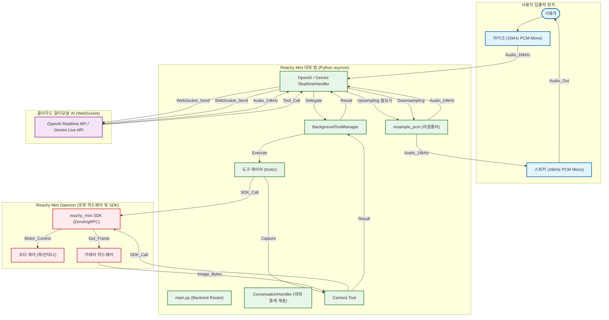
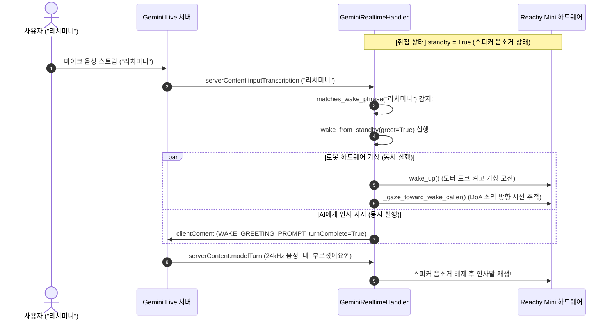
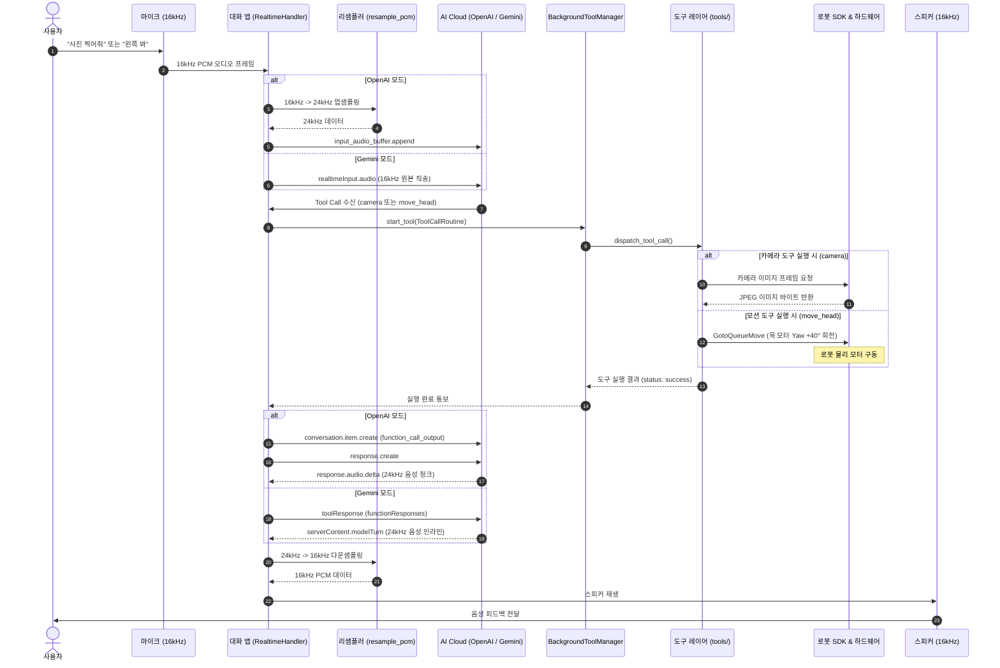

# Reachy Mini 실시간 대화형 AI 시스템 완벽 통합 강의 명세서

> **부제:** OpenAI Realtime API vs Google Gemini Live 기반 양방향 음성·비전 스트리밍 파이프라인, 비동기 이중 루프(Double-Loop) 아키텍처, 오디오 리샘플링 경로, Tool Calling 어댑터 패턴 및 하드웨어 모션 제어 심층 분석

---

## 목차
1. [시스템 전체 아키텍처 및 런타임 구조](#1-시스템-전체-아키텍처-및-런타임-구조)
2. [OpenAI Realtime vs Gemini Live 통신 및 스펙 심층 비교](#2-openai-realtime-vs-gemini-live-통신-및-스펙-심층-비교)
3. [오디오 입출력 신호 처리 및 리샘플링 파이프라인](#3-오디오-입출력-신호-처리-및-리샘플링-파이프라인)
4. [도구(Tool) 설정 및 프로필 관리 체계](#4-도구tool-설정-및-프로필-관리-체계)
5. [Tool Calling 프로토콜 규격 및 2단계 파싱 아키텍처](#5-tool-calling-프로토콜-규격-및-2단계-파싱-아키텍처)
6. [대화 주입 및 응답 유도 메커니즘 (`conversation.item.create` vs `clientContent`)](#6-대화-주입-및-응답-유도-메커니즘-conversationitemcreate-vs-clientcontent)
7. [웨이크 워드 감지 및 소리 방향 추적(DoA) 기상 시퀀스](#7-웨이크-워드-감지-및-소리-방향-추적doa-기상-시퀀스)
8. [종합 시퀀스 다이어그램 (End-to-End Execution Flow)](#8-종합-시퀀스-다이어그램-end-to-end-execution-flow)
9. [환경 설정(.env) 및 실무 확장 가이드](#9-환경-설정env-및-실무-확장-가이드)
10. [수업 및 강의용 핵심 요약/Q&A](#10-수업-및-강의용-핵심-요약qa)

---

## 1. 시스템 전체 아키텍처 및 런타임 구조

Reachy Mini 대화 애플리케이션은 사용자 음성을 캡처하여 클라우드 멀티모달 LLM으로 실시간 전송하고, 모델의 음성 응답을 재생함과 동시에 카메라 촬영 및 모터 관절(Yaw/Pitch/Roll)을 제어하는 피지컬 컴퓨팅 시스템입니다.

### 1.1 전체 시스템 구조도 (Flowchart)



### 1.2 주요 구성 요소별 역할
1. **대화 중계 계층 (`ConversationHandler`)**:
   - 애플리케이션의 핵심 루프를 구동하며, 실시간 백엔드 연결 상태 관리, 마이크 입력 스트림과 오디오 출력 스트림을 로봇 SDK와 중계합니다.
   - LLM의 도구 호출(Tool Call) 요청을 받아 실제 도구 객체를 매핑하고 비동기로 디스패치합니다.
2. **실시간 API 백엔드 핸들러 (`OpenAIRealtimeHandler` / `GeminiRealtimeHandler`)**:
   - 클라우드사와의 영속적인 전이중 WebSocket 연결을 수립하고 유지합니다.
   - 플랫폼별 오디오 샘플링 레이트 변환(리샘플링) 및 Base64 인코딩/디코딩을 전담합니다.
   - 시스템 프롬프트(페르소나)와 도구 명세(JSON Schema)를 세션 초기화 시점에 서버에 등록합니다.
3. **도구 실행 계층 (`tools/` & `BackgroundToolManager`)**:
   - LLM이 호출 가능한 동작들을 모듈화한 계층입니다. (`move_head`, `play_emotion`, `camera`, `dance` 등)
   - 도구 실행 도중 음성 스트리밍 이벤트 루프가 멈추지(blocking) 않도록 백그라운드 태스크로 격리 구동합니다.
4. **로봇 하드웨어 및 SDK 계층 (`reachy_mini` 패키지)**:
   - 로봇 내부 데몬(`reachy-mini-daemon`)과 Zenoh 통신을 주고받는 최하단 드라이버 계층입니다.
   - 모터 관절 각도 목표치(`GotoQueueMove`)를 하드웨어로 전달하고, 카메라 프레임을 파이썬 이미지 바이트로 래핑하여 반환합니다.

### 1.3 백엔드 분기 플로우 (`main.py:L128-L248`)
```
                  [ 앱 시작 (main.py) ]
                            │
               CONVERSATION_BACKEND 값 검사
              ┌─────────────┴─────────────┐
              ▼                           ▼
          "openai"                     "gemini"
              │                           │
      OPENAI_API_KEY 검증         GEMINI_API_KEY 검증
              │                           │
  OpenAIRealtimeHandler 생성   GeminiRealtimeHandler 생성
```

---

## 2. OpenAI Realtime vs Gemini Live 통신 및 스펙 심층 비교

OpenAI Realtime과 Gemini Live는 둘 다 양방향 WebSocket(전이중 통신)을 사용하지만, 통신 아키텍처, 프로토콜 설계 철학, 메시지 구조(이벤트 기반 vs 컨테이너 기반)에서 본질적인 차이가 존재합니다.

### 2.1 연결, 인증 및 아키텍처 비교

| 비교 항목 | OpenAI Realtime (`openai`) | Google Gemini Live (`gemini`) |
| :--- | :--- | :--- |
| **기본 모델** | `gpt-realtime-mini` (또는 `gpt-realtime`) | `gemini-3.1-flash-live-preview` |
| **필수 API 키** | `OPENAI_API_KEY` | `GEMINI_API_KEY` |
| **연결 방식** | 공식 SDK (`client.beta.realtime.connect`) | 순수 Python `websockets.connect` 직접 연결 |
| **엔드포인트 URL** | `wss://api.openai.com/v1/realtime?model=gpt-realtime-mini` | `wss://generativelanguage.googleapis.com/ws/google.ai.generativelanguage.v1beta.GenerativeService.BidiGenerateContent?key=...` |
| **인증 방식** | HTTP Header (`Authorization: Bearer <KEY>`, `OpenAI-Beta: realtime=v1`) | URL Query Parameter (`?key=<KEY>`) |
| **핸들러 파일** | `openai_realtime.py:L366` (`HuggingFaceRealtimeHandler` 상속) | `gemini_realtime.py:L263` (`ConversationHandler` 직접 구현) |
| **마이크 입력 규격** | **24,000 Hz** (16kHz 마이크 $\rightarrow$ 24kHz 업샘플링 필수) | **16,000 Hz** (로봇 마이크 규격 무변환 직송) |
| **스피커 출력 규격** | 24,000 Hz (클라이언트에서 16kHz로 다운샘플링) | 24,000 Hz (클라이언트에서 16kHz로 다운샘플링) |
| **오디오 포맷** | 무압축 PCM 16-bit Little-Endian, Mono, Base64 | 무압축 PCM 16-bit Little-Endian, Mono, Base64 |
| **비전(카메라) 스트림** | 도구 호출 시 단발성 이미지 전송 중심 | WebSocket 세션 내 `realtimeInput.video` 실시간 스트림 네이티브 지원 |
| **VAD / 끼어들기** | Server VAD (`input_audio_buffer.speech_started` / `speech_stopped`) | Native VAD (`serverContent.interrupted: true`) |
| **보이스 카탈로그** | `marin`(기본), `cedar`, `alloy`, `ash`, `ballad` 등 10종 | `Kore`(기본), `Aoede`, `Charon`, `Fenrir`, `Puck` 등 8종 |

### 2.2 세션 설정(Setup) 방식 비교

연결 직후 음성, 모델, 시스템 지침, 도구 목록을 서버에 등록하는 방식입니다.

#### (1) OpenAI: `session.update` 이벤트
연결 후 클라이언트가 명시적인 이벤트를 전송하여 세션 파라미터를 갱신합니다.
```json
{
  "type": "session.update",
  "session": {
    "modalities": ["audio", "text"],
    "voice": "marin",
    "instructions": "너는 Reachy Mini 로봇이다...",
    "tools": [
      {
        "type": "function",
        "name": "move_head",
        "description": "머리를 회전합니다",
        "parameters": {
          "type": "object",
          "properties": {
            "direction": {"type": "string", "enum": ["left", "right", "up", "down", "front"]}
          },
          "required": ["direction"]
        }
      }
    ],
    "input_audio_format": "pcm16",
    "output_audio_format": "pcm16"
  }
}
```

#### (2) Gemini: `setup` 핸드셰이크
연결 즉시 첫 번째 프레임으로 `setup` 페이로드를 전송하며, 서버가 `setupComplete`로 응답해야 통신이 활성화됩니다.
```json
{
  "setup": {
    "model": "models/gemini-3.1-flash-live-preview",
    "generationConfig": {
      "responseModalities": ["AUDIO"],
      "speechConfig": {
        "voiceConfig": {
          "prebuiltVoiceConfig": {"voiceName": "Kore"}
        }
      }
    },
    "systemInstruction": {
      "parts": [{"text": "너는 Reachy Mini 로봇이다..."}]
    },
    "tools": [
      {
        "functionDeclarations": [
          {
            "name": "move_head",
            "description": "머리를 회전합니다",
            "parameters": {
              "type": "object",
              "properties": {
                "direction": {"type": "string", "enum": ["left", "right", "up", "down", "front"]}
              },
              "required": ["direction"]
            }
          }
        ]
      }
    ]
  }
}
```

### 2.3 데이터 송신(Uplink) 및 수신(Downlink) 구조 비교

#### Uplink (Client $\rightarrow$ Server)
| 전송 데이터 | OpenAI Realtime (세분화된 Action 단위) | Gemini Live (실시간 입력 컨테이너) |
| :--- | :--- | :--- |
| **마이크 음성** | `input_audio_buffer.append` (24kHz PCM Base64) | `realtimeInput.audio` (16kHz PCM Base64) |
| **카메라 영상** | 도구 호출 시 단발 전송 | `realtimeInput.video` (JPEG Base64 실시간 스트림) |
| **대화 텍스트 주입** | `conversation.item.create` + `response.create` (2단계) | `clientContent` (`turnComplete: true` 일체형 1단계) |
| **도구 실행 결과** | `conversation.item.create` (`type: "function_call_output"`) | `toolResponse` (`functionResponses: [{id, name, response}]`) |

#### Downlink (Server $\rightarrow$ Client)
* **OpenAI (세분화된 이벤트 모델 - `huggingface_realtime.py:L750-L865`)**:
  - `input_audio_buffer.speech_started` : 사용자 발화 시작 (VAD)
  - `response.output_audio.delta` : AI 음성 조각 (오디오 바이너리만 포함)
  - `response.output_audio_transcript.done` : AI 답변 텍스트 전사
  - `response.function_call_arguments.done` : 도구 호출 명령
  - `response.done` : 턴 종료
* **Gemini (계층형 컨테이너 모델 - `gemini_realtime.py:L357-L430`)**:
  - 서버가 `serverContent` 또는 `toolCall` 상위 컨테이너 객체 안에 오디오, 텍스트, 상태 플래그를 한 번에 패킹하여 전달합니다.
```json
{
  "serverContent": {
    "modelTurn": {
      "parts": [
        {"inlineData": {"mimeType": "audio/pcm;rate=24000", "data": "<24kHz Base64 오디오>"}},
        {"text": "머리를 왼쪽으로 돌렸습니다."}
      ]
    },
    "interrupted": false,
    "outputTranscription": {"text": "머리를 왼쪽으로 돌렸습니다."},
    "turnComplete": true
  }
}
```

---

## 3. 오디오 입출력 신호 처리 및 리샘플링 파이프라인

로봇의 물리 마이크/스피커는 16 kHz로 구동되지만, 클라우드 AI 모델은 24 kHz 오디오 규격을 채택하고 있어 실시간 리샘플링과 에코 차단 필터가 필수적입니다.

### 3.1 오디오 입출력 경로 다이어그램

```
[마이크 입력 경로 (Microphone Input)]
• 하드웨어 마이크: 16,000 Hz (16 kHz PCM16 Mono Little-Endian)

  1) OpenAI 경로:
     마이크 (16 kHz)
        ──> [resample_pcm (업샘플링)] 
        ──> 24 kHz Base64 인코딩 
        ──> input_audio_buffer.append 전송 (클라이언트 CPU 연산 오버헤드 발생)

  2) Gemini 경로:
     마이크 (16 kHz)
        ──> 리샘플링 없음 (Raw 16 kHz 유지) 
        ──> Base64 인코딩 
        ──> realtimeInput.audio 전송 (지연 시간 최소화)

──────────────────────────────────────────────────────────────────────────

[스피커 출력 경로 (Speaker Output - 공통)]
• AI 서버 출력: 24,000 Hz (24 kHz PCM16 Mono)
• 하드웨어 스피커: 16,000 Hz (16 kHz)

  클라우드 응답 수신 (24 kHz Base64)
     ──> Base64 디코딩
     ──> [resample_pcm (다운샘플링 + Anti-Aliasing 필터)]
     ──> 16 kHz PCM16 변환
     ──> 로봇 스피커 버퍼 큐 전달 및 물리 사운드 출력
```

### 3.2 리샘플링 함수 구현 (`openai_realtime.py:L112-L138`)
```python
def resample_pcm(
    pcm_data: bytes, 
    orig_sr: int, 
    target_sr: int, 
    channels: int = 1
) -> bytes:
    """PCM 바이트 배열을 선형 보간 및 안티앨리어싱 필터를 거쳐 목표 샘플레이트로 변환"""
    if orig_sr == target_sr:
        return pcm_data
    audio_np = np.frombuffer(pcm_data, dtype=np.int16)
    # Scipy resample_poly 등을 활용하여 주파수 왜곡 없이 정밀 변환
    resampled_np = signal.resample_poly(audio_np, target_sr, orig_sr).astype(np.int16)
    return resampled_np.tobytes()
```

### 3.3 음향 에코 방지 (Acoustic Echo Gating)
로봇 스피커에서 소리가 출력되는 도중 마이크가 자신의 음성을 주워 담아 무한 루프를 도는 하울링 현상을 차단합니다:
- 모델 발화 시작 시 `shared_state["speaking"] = True` 설정
- 발화가 끝날 때까지 마이크 입력 프레임의 서버 전송을 차단(Gate/Mute)하거나 입력 버퍼를 드레인
- 사용자가 발화를 시작하여 VAD(끼어들기/Barge-in)가 감지되면 즉시 스피커 재생 큐를 비우고 `shared_state["speaking"] = False`로 복구

---

## 4. 도구(Tool) 설정 및 프로필 관리 체계

Reachy Mini 프로젝트에서는 **"어떤 도구를 활성화할 것인가(프로필)"**와 **"각 도구의 동작과 파라미터는 무엇인가(도구 스펙)"**를 분리하여 모듈형으로 관리합니다.

```
[설정 아키텍처]
profiles/desk_companion_ko/profile.md (활성화할 도구 이름 리스트)
              │
              ▼ 로드 및 검증
src/reachy_mini_conversation_app/tools/ (도구 클래스 및 파라미터 정의)
   ├── move_head.py
   ├── camera.py
   ├── play_emotion.py
   └── ...
              │
              ▼ get_tool_specs() 취합
gemini_realtime.py (_send_setup) / openai_realtime.py (session.update)
              │
              ▼ WebSocket을 통해 클라우드 서버에 등록
```

### 4.1 도구 활성화 설정 파일 (`profiles/desk_companion_ko/profile.md`)
프로필 상단의 TOML 프론트매터(`+++`) 영역에 활성화할 도구 명단을 정의합니다:
```toml
+++
schema_version = 1
default_tools = [
  "dance",
  "stop_dance",
  "play_emotion",
  "stop_emotion",
  "camera",
  "idle_do_nothing",
  "move_head",
  "go_to_sleep",
  "sweep_look",
  "remember",
  "forget",
  "head_tracking",
  "pomodoro_timer",
]
+++
```
*(적용 프로필은 `.env`의 `REACHY_MINI_CUSTOM_PROFILE=desk_companion_ko`로 지정)*

### 4.2 도구 스펙 및 로직 정의 (`tools/move_head.py:L14-L30`)
```python
class MoveHead(Tool):
    name = "move_head"
    description = "Move your head in a given direction: left, right, up, down or front."
    parameters_schema = {
        "type": "object",
        "properties": {
            "direction": {
                "type": "string",
                "enum": ["left", "right", "up", "down", "front"],
            },
        },
        "required": ["direction"],
    }

    async def __call__(self, deps: ToolDependencies, direction: str) -> Dict[str, Any]:
        deltas = {"left": (0, 0, 0, 0, 0, 40), ...}
        # 모터 제어 명령 생성 및 큐 등록
        return {"status": "success", "message": f"Head moving {direction}"}
```

### 4.3 도구 취합 및 전송 (`gemini_realtime.py:L287-L321`)
```python
async def _send_setup(self, ws: Any) -> None:
    tool_specs = get_tool_specs()
    function_declarations = [
        {
            "name": spec["name"],
            "description": spec["description"],
            "parameters": spec["parameters"],
        }
        for spec in tool_specs
    ]
    setup_payload = {
        "model": self.model,
        "tools": [{"functionDeclarations": function_declarations}],
        ...
    }
    await ws.send(json.dumps({"setup": setup_payload}))
```

---

## 5. Tool Calling 프로토콜 규격 및 2단계 파싱 아키텍처

AI 모델로부터 Tool Call 요청을 받아 로봇을 제어하기까지, 시스템은 **"1단계: 수신 및 규격 통일"**과 **"2단계: 공통 파이썬 인자 파싱 및 실행"**으로 분리된 어댑터 패턴을 취합니다.

### 5.1 2단계 파싱 아키텍처 흐름도

```
[OpenAI 이벤트 수신]                         [Gemini JSON 패킷 수신]
huggingface_realtime.py:862                  gemini_realtime.py:362
event.arguments (str)                        call["args"] (dict)
        │                                            │
        │                                    json.dumps(args) 직렬화
        ▼                                            ▼
   ToolCallRoutine(tool_name="move_head", args_json_str='{"direction": "left"}')
                                   │
                                   ▼ 백그라운드 태스크 전달
            BackgroundToolManager.start_tool() -> _run_tool()
                                   │
                                   ▼ 공통 디스패처 호출
                     core_tools.py: dispatch_tool_call()
                                   │
                                   ▼ 공통 JSON 파싱
                     core_tools.py: _safe_load_obj()  --> json.loads()
                                   │
                                   ▼ 파이썬 dict 생성: {"direction": "left"}
                     MoveHead.__call__(deps, direction="left")
```

### 5.2 1단계: 수신 위치 및 규격 통일

#### (1) OpenAI 수신 코드 (`huggingface_realtime.py:L862-L895`)
OpenAI는 `arguments`가 이미 문자열 형태로 전달됩니다.
```python
if event.type == "response.function_call_arguments.done":
    tool_name = getattr(event, "name", None)
    args_json_str = getattr(event, "arguments", None)  # '{"direction": "left"}'
    call_id: str = str(getattr(event, "call_id", uuid.uuid4()))

    background_tool = await self.tool_manager.start_tool(
        call_id=call_id,
        tool_call_routine=ToolCallRoutine(
            tool_name=tool_name,
            args_json_str=args_json_str,
            deps=self.deps,
        ),
        is_idle_tool_call=False,
    )
```

#### (2) Gemini 수신 코드 (`gemini_realtime.py:L362-L375`)
Gemini는 `args`가 Python dict 형태로 오므로, 공통 규격(`args_json_str`)에 맞추기 위해 `json.dumps()`로 직렬화합니다.
```python
if "toolCall" in data:
    tc = data["toolCall"]
    for call in tc.get("functionCalls", []):
        call_id = str(call.get("id", ""))
        name = str(call.get("name", ""))
        args = call.get("args") or {}        # dict: {"direction": "left"}
        args_json = json.dumps(args)         # 규격 통일을 위해 문자열 변환

        routine = ToolCallRoutine(tool_name=name, args_json_str=args_json, deps=self.deps)
        await self.tool_manager.start_tool(call_id=call_id, tool_call_routine=routine, is_idle_tool_call=False)
```

### 5.3 캡슐화 객체: `ToolCallRoutine` (`background_tool_manager.py:L36-L53`)
`ToolCallRoutine`은 일반 함수가 아니라, 비동기 도구 실행 정보를 캡슐화한 **Pydantic 모델 클래스**입니다.
```python
class ToolCallRoutine(BaseModel):
    """지연 실행을 위해 비동기 호출 가능 객체와 인자를 캡슐화하는 모델"""
    model_config = {"arbitrary_types_allowed": True}

    tool_name: str
    args_json_str: str
    deps: "ToolDependencies"

    async def __call__(self, tool_manager: BackgroundToolManager) -> Any:
        """백그라운드 워커에 의해 호출될 때 실행"""
        if self.tool_name in _SYSTEM_TOOL_NAMES:
            return await dispatch_tool_call_with_manager(
                tool_name=self.tool_name, args_json=self.args_json_str, deps=self.deps, tool_manager=tool_manager
            )
        return await dispatch_tool_call(tool_name=self.tool_name, args_json=self.args_json_str, deps=self.deps)
```

### 5.4 2단계: 공통 파싱 및 실행 함수 (`core_tools.py:L454-L480`)
어떤 백엔드를 거쳤든 최종적으로 인자를 dict로 변환하고 언패킹(`**args`)하는 로직은 단 한 곳에서 처리됩니다.
```python
def _safe_load_obj(args_json: str) -> Dict[str, Any]:
    """JSON 문자열을 안전하게 파이썬 dict로 역직렬화"""
    try:
        parsed_args = json.loads(args_json or "{}")
        return parsed_args if isinstance(parsed_args, dict) else {}
    except Exception:
        logger.warning("bad args_json=%r", args_json)
        return {}

async def _dispatch_tool_call(tool_name: str, args: Dict[str, Any], deps: ToolDependencies) -> Dict[str, Any]:
    tool = get_tools().get(tool_name)
    if not tool:
        return {"error": f"unknown tool: {tool_name}"}
    try:
        # 딕셔너리를 언패킹(**args)하여 도구의 __call__ 실행!
        return await tool(deps, **args)
    except Exception as e:
        return {"error": f"{type(e).__name__}: {e}"}

async def dispatch_tool_call(tool_name: str, args_json: str, deps: ToolDependencies) -> Dict[str, Any]:
    return await _dispatch_tool_call(tool_name, _safe_load_obj(args_json), deps)
```

---

## 6. 대화 주입 및 응답 유도 메커니즘 (`conversation.item.create` vs `clientContent`)

대화 세션 도중 사용자가 직접 마이크로 말하지 않았더라도, 애플리케이션이 AI 모델의 대화 문맥(Context)에 특정 사실을 기록하거나 말을 걸도록 만들어야 하는 상황이 있습니다.

### 6.1 OpenAI: `conversation.item.create`의 원리와 필요성
`conversation.item.create`는 **"AI의 대화창(기록장)에 새로운 쪽지를 직접 한 장 끼워 넣는 명령"**입니다.
* **카카오톡 비유**: 사용자가 타이핑하지 않아도 "OO님이 입장하셨습니다", "투표 결과: [보기]"처럼 시스템 공지 쪽지가 단톡방에 올라오는 것과 같습니다.
* **주요 사용 상황**:
  1. **도구 실행 결과 보고서 제출 (`huggingface_realtime.py:L633-L639`)**:
     ```python
     await self.connection.conversation.item.create(
         item={
             "type": "function_call_output",
             "call_id": completed_tool.id,
             "output": '{"status": "success", "message": "Head moving left"}',
         },
     )
     ```
  2. **웨이크 워드로 깨어날 때 가상 발화 주입 (`openai_realtime.py:L293-L299`)**:
     ```python
     await self.connection.conversation.item.create(
         item={
             "type": "message",
             "role": "user",
             "content": [{"type": "input_text", "text": "(사용자가 방금 너를 깨웠다. 한국어로 반갑게 인사하라.)"}],
         },
     )
     ```
* **주의점 (2단계 필수)**: `conversation.item.create`는 기록만 남기는 동작입니다. AI가 그 쪽지를 읽고 실제로 음성을 말하게 하려면 반드시 **`response.create`를 연이어 전송**해야 합니다.

### 6.2 Gemini: `clientContent`의 일체형 원샷 구조
Gemini Live는 OpenAI와 달리 텍스트 주입과 응답 트리거를 **`clientContent` + `turnComplete: True`**를 통해 한 번에 처리합니다 (`gemini_realtime.py:L339-L355`).
```python
async def _send_user_turn(self, text: str) -> None:
    """사용자가 말한 것처럼 텍스트를 주입하고 즉시 음성 답변 유도"""
    msg = {
        "clientContent": {
            "turns": [
                {
                    "role": "user",
                    "parts": [{"text": text}],
                }
            ],
            "turnComplete": True,  # "입력이 끝났으니 모델 너가 즉시 대답해!"
        }
    }
    await self.ws.send(json.dumps(msg))
```

---

## 7. 웨이크 워드 감지 및 소리 방향 추적(DoA) 기상 시퀀스

로봇이 절전/대기 상태(`standby = True`)에 있을 때는 음성 생성을 억제(스피커 Mute)하지만, 백그라운드 STT는 계속 작동하여 웨이크 워드가 들리면 즉시 기상합니다.

### 7.1 Gemini 기상 시퀀스 다이어그램 (`"리치미니"`)



### 7.2 소스 코드 동작 단계
1. **웨이크 워드 매칭 (`gemini_realtime.py:L400-L409`)**:
   ```python
   if self._standby and matches_wake_phrase(user_text, configured_wake_phrases()):
       loop.create_task(self.wake_from_standby())
   ```
2. **모터 기상 및 DoA 시선 제어 (`gemini_realtime.py:L631-L647`)**:
   - `self._standby = False` 플래그 해제
   - `robot.wake_up()` 기상 모션 구동
   - 마이크 어레이가 측정한 소리 진원지 각도(DoA, Direction of Arrival)를 읽어 목 Yaw 각도를 사용자 방향으로 회전
3. **인사 프롬프트 전달 (`gemini_realtime.py:L676-L683`)**:
   ```python
   # WAKE_GREETING_PROMPT = "(사용자가 방금 웨이크 워드로 너를 깨웠다. 한국어로 짧고 반갑게 인사하고 무엇을 도울지 물어보라.)"
   await self._send_user_turn(WAKE_GREETING_PROMPT)
   ```

---

## 8. 종합 시퀀스 다이어그램 (End-to-End Execution Flow)

### 8.1 도구 실행 및 카메라 촬영 종합 시퀀스
사용자의 음성 명령에 따라 카메라 프레임을 읽어오거나 관절 모터를 회전시키는 전체 시간 순서도입니다.



---

## 9. 환경 설정(.env) 및 실무 확장 가이드

### 9.1 환경 설정 템플릿 (`.env`)

#### Gemini Live 사용 시
```bash
CONVERSATION_BACKEND=gemini
GEMINI_API_KEY="your-gemini-api-key"
GEMINI_LIVE_MODEL="gemini-3.1-flash-live-preview"
GEMINI_VOICE="Kore"
REACHY_MINI_CUSTOM_PROFILE=desk_companion_ko
```

#### OpenAI Realtime 사용 시
```bash
CONVERSATION_BACKEND=openai
OPENAI_API_KEY="your-openai-api-key"
OPENAI_REALTIME_MODEL="gpt-realtime-mini"
OPENAI_VOICE="marin"
REACHY_MINI_CUSTOM_PROFILE=desk_companion_ko
```

### 9.2 신규 도구(Tool) 추가 3단계 체크리스트
1. **도구 클래스 생성**: `src/reachy_mini_conversation_app/tools/` 경로에 신규 파일(예: `nod_head.py`)을 만들고 `Tool` 클래스를 상속받아 `name`, `description`, `parameters_schema`, `__call__`을 구현합니다.
2. **도구 등록**: `src/reachy_mini_conversation_app/tools/__init__.py` 또는 `core_tools.py`에 모듈을 노출합니다.
3. **프로필에 추가**: `profiles/desk_companion_ko/profile.md` 파일의 `default_tools` 배열에 `"nod_head"` 문자열을 추가합니다.

---

## 10.  요약/Q&A

### Q1. 도구 실행 완료 후 왜 OpenAI는 2단계를 거치고, Gemini는 1단계로 끝나나요?
* **OpenAI**는 대화 기록장(`conversation.item.create`)에 쪽지를 꽂는 행위와 AI에게 말을 시키는 행위(`response.create`)가 분리되어 있습니다.
* **Gemini**는 프로토콜 상 `toolResponse` 메시지 자체가 "도구 결과가 도착했으니 즉시 다음 발화를 생성하라"는 트리거를 겸하도록 설계되어 있어 왕복 통신 단계가 더 간결합니다.

### Q2. 모터가 회전하는 동안 왜 WebSocket 연결이 끊어지지 않나요?
* 도구 호출이 발생했을 때 메인 비동기 루프에서 모터 대기(`time.sleep`)를 직접 실행하지 않고, `BackgroundToolManager` 및 `asyncio.to_thread`를 사용하여 별도 백그라운드 워커 스레드로 작업을 격리했기 때문입니다. 오디오 스트리밍 루프는 1ms의 중단 없이 유지됩니다.

### Q3. 지연 시간(Latency) 면에서 두 백엔드의 실질적 차이는 무엇인가요?
* **입력 단계**: Gemini는 16 kHz 마이크 데이터를 리샘플링 없이 그대로 보내므로 클라이언트 CPU 부하 및 변환 지연이 없습니다. 반면 OpenAI는 16 kHz $\rightarrow$ 24 kHz 업샘플링 연산이 실시간으로 수행됩니다.
* **출력 단계**: 두 엔진 모두 24 kHz 음성을 클라이언트로 반환하므로 16 kHz 스피커 재생을 위한 다운샘플링 과정은 동일합니다.